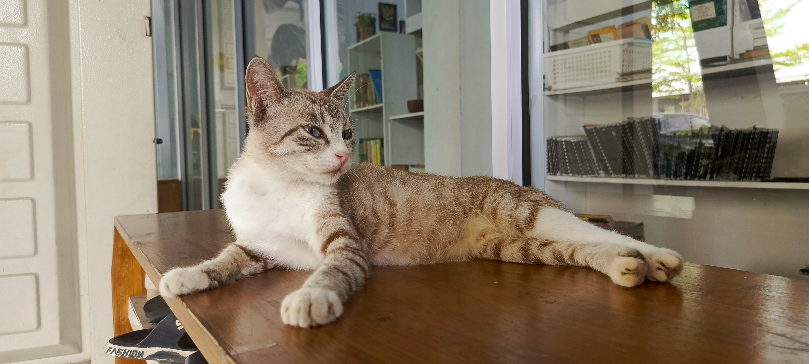

<h1 align="center">Hi there! 👋 I'm Lionel Juis Gerardo 😄</h1>

  
  
  
  
  

### About me

- 💻 Web developer who loves building clean, modern, and responsive websites

- 🌱 Always learning new tech and improving my skills every day
- 🔧 Technologies I work with: HTML, CSS, JavaScript, React, Tailwind CSS, Node.js, PostgreSQL
- 🌐 Check out my work: [awi-portofolio.vercel.app](https://awi-portofolio.vercel.app/)
- ⚡ Fun fact: I love solving problems and seeing ideas come to life on screen!

### Languages and Tools

  &nbsp;&nbsp;
  &nbsp;&nbsp;
  &nbsp;&nbsp;
  &nbsp;&nbsp;
  &nbsp;&nbsp;
  &nbsp;&nbsp;
  &nbsp;&nbsp;
  &nbsp;&nbsp;
  &nbsp;&nbsp;
  

### GitHub Stats

### GitHub Stats

  
  &nbsp;&nbsp;&nbsp;
  

  <a href="https://awi-portofolio.vercel.app/"><b>🌐 Visit my portfolio</b></a>

